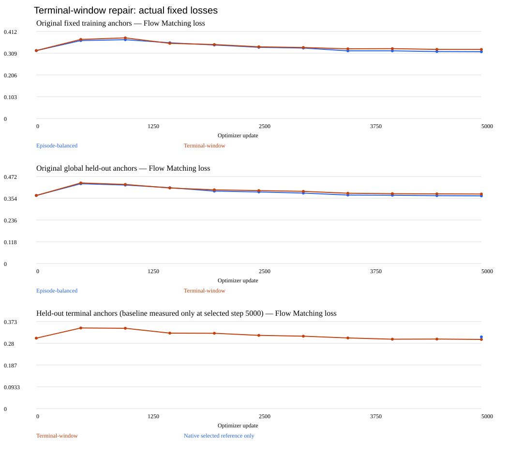

# EmbodiedOps

**Reproducible VLA fine-tuning, manipulation failure analysis and repair verification.**

EmbodiedOps connects SmolVLA Flow Matching training to actual RoboCasa/MuJoCo
`CloseFridge` execution. It records what the policy saw, what it commanded, what
the robot did and whether a proposed repair passed a separate acceptance gate.
The executed orchestration backend uses deterministic evidence rules.

**Result:** real training and closed-loop evaluation are complete; no candidate
established a reliable robot-success improvement. Negative results are retained,
including an optimizer-precision ablation and targeted terminal-window sampling.
This is a simulation research case study, not an official benchmark reproduction.

## Start here

- [Three-minute local demo and speaker script](docs/DEMO.md): authentic successful
  and failed rollouts, measured training curves and a rejected repair.
- [Technical overview](docs/TECHNICAL_OVERVIEW.md): objective, dataset, interfaces,
  controller, tools and experimental controls.
- [English / 中文 resume material and interview answers](docs/INTERVIEW.md).
- [Verified evidence ledger](RESUME_EVIDENCE.md).

```text
Saved failure evidence → contract / instruction / physical probes
                     → versioned configuration or learning candidate
                     → checkpoint verification → matched RoboCasa episodes
                     → independent acceptance / rejection
```

## What is implemented

- **SmolVLA fine-tuning:** native masked Flow Matching, frozen VLM, trainable
  action expert and state projection; reproducible samples/noise, gradient and
  weight-change audits, fixed validation curves and checkpoint selection.
- **Demonstration data:** 513 CloseFridge episodes / 155,443 frames; 461 training
  and 52 episode-disjoint validation episodes. Local validation overlap with the
  released model's pretraining data is unknown.
- **Closed-loop manipulation:** three RGB cameras, 16D state, 12D controller
  action, saved normalization, 50-action predictions and 10 flow steps. Actual
  task predicates, individual door angles, trajectories and latency are recorded.
- **Physical diagnostics:** geometry identities and positive MuJoCo solver
  contact forces, separate from visual proximity. Privileged simulator diagnostics
  are not added to policy inputs.
- **Bounded deterministic orchestration:** a tool registry, evidence-dependent
  routing, versioned candidates, subprocess budgets and acceptance gates.
  Historical hypotheses and later experimental designs were human-directed;
  they were not discoveries by an autonomous LLM.
- **Matched evaluation:** reset/camera/model/processor contracts, retained failures
  and invalid-episode exclusions, with final seeds gated separately.

## Measured findings

The learning comparison below uses `CloseFridge` task-ID conditioning,
H=50, 600-action cap and diagnostic seeds **43–46**. Counts describe these four
development scenes, not population success rates.

| Model / method | Updates | Global held-out loss | Actual diagnostic success | Outcome |
|---|---:|---:|---:|---|
| Pinned pretrained | 0 | 0.369275 | 1/4 | Reference |
| Episode-balanced | 5,000 | 0.367256 | 1/4 | Rejected: no success gain; force regression |
| Motion-mixture | 5,000 | 0.370945 | 0/4 | Rejected: lost success and physical regressions |
| FP32 master | 5,000 | 0.387121 | **Not evaluated** | Negative optimization result; full reload blocked |
| Terminal-window | 5,000 | 0.377230 | 1/4 | Rejected: door/force/global-loss regressions |

- **Motion-mixture:** balancing inferred motion regimes did not repair execution.
  Those regimes are action/state proxies, not verified contact or manipulation
  stages. [Training report](environment/learning-repair-v1.md) ·
  [completed diagnostic matrix](environment/learning-repair-v1-completion.md).
- **FP32 masters:** all 33 normalization tensors unchanged in native training
  changed in actual BF16 forward weights. This numerical correction worsened
  early and final validation loss. Serialized integrity checks passed, but an
  independent sustained-checkpoint reload timed out; no robot result is claimed.
  [Negative ablation](environment/optimizer-precision-v1.md).
- **Terminal windows:** reward-aligned sampling reduced terminal held-out loss
  from **0.307188 to 0.296408**, while seed 43's residual opening worsened from
  **13.11° to 90.00°**. All five content reload checks passed; one exceeded its
  runtime cap. [Report](environment/terminal-window-experiment-v1.md) ·
  [compact numerical evidence](environment/terminal-window-experiment-v1-results.json).

The earlier **natural-language baseline is a different experiment**. In the
three-seed instruction probe, pretrained NL conditioning achieved 0/3 versus
1/3 with the bare `CloseFridge` task ID. The earlier 300-update NL comparison was
0/10 pretrained versus 3/10 fine-tuned, with worse fixed held-out loss. These
small, different protocols cannot be pooled into an official or generalization
claim. [Instruction probe](environment/phase1e.md) · [early fine-tuning](environment/phase1d.md).

Final seeds **120–123 remain unused**: no candidate qualified. A camera-invalid
attempt was preserved and excluded, then only the missing registered pairs were
completed after renderer validation. Contact-force gates are comparative simulator
checks, not hardware safety certification.



The terminal loss measures successful demonstration windows, not robot task
success. The native terminal reference was measured only at the selected
checkpoint. [All four paired door traces](docs/assets/terminal-window-doors.svg)
and the [delivery review](docs/DELIVERY_REVIEW.md) remain available in a source-only clone.

## Reproduce the presentation without running a policy

With the existing local artifact tree:

```powershell
python -B scripts/build_portfolio_demo.py --output outputs/portfolio-demo-v1
# Open outputs/portfolio-demo-v1/index.html in a browser.
```

This standard-library script checks recorded outcomes and hashes, then references
existing videos and plots. It performs no model loading, training, inference,
physics or network requests. It refuses an existing output directory.
Videos/checkpoints/caches are intentionally excluded from Git; a source-only clone
can read the reports and compact JSON, but cannot play missing local recordings.

Lightweight implementation checks, using the pinned environment:

```powershell
conda activate embodiedops-robocasa
python -B -m unittest discover -s tests -v
```

Tests include tiny CPU optimizer and MuJoCo contact fixtures, not RoboCasa policy
episodes. Experiment commands in the reports require pinned assets, fresh output
directories and explicit compute approval. No new run is needed to view the demo.

## Environment and scope

Executed on Windows 11 / RTX 3060 Laptop 6 GB: LeRobot 0.6.1, RoboCasa 1.0.0,
robosuite 1.5.2, MuJoCo 3.3.1, PyTorch 2.11.0+cu128.
See [policy environment](environment/policy.md),
[simulation environment](environment/simulation.md) and pinned Phase1A/1B manifests.
The separate PushT and Panda Lift environments are historical regression backends.

No autonomous LLM reasoning, world-model training, real hardware deployment or
proven success-rate improvement is claimed. The external reasoning endpoint
adapter is untested and was unused. The contribution is an auditable connection
between VLA optimization, physical failure evidence and repair rejection.
